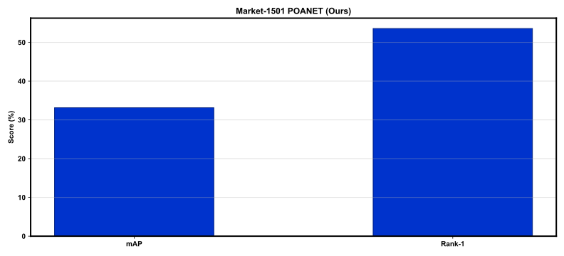
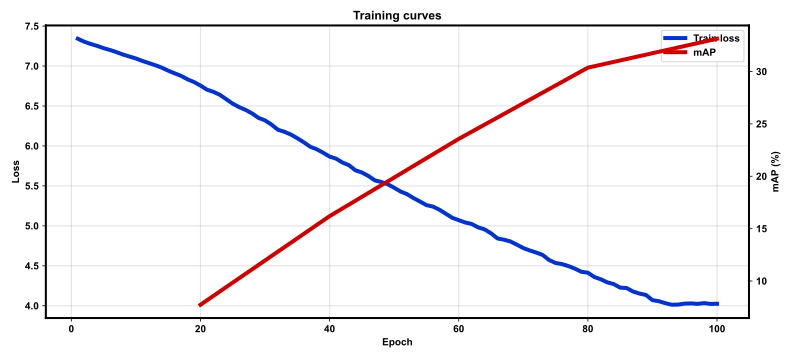

# Report: POANET

Market-1501 rebuild of Dutta et al., TBIOM 2026 (DOI [10.1109/TBIOM.2025.3641048](https://doi.org/10.1109/TBIOM.2025.3641048)).

## Setup

- Image: 384×128, ResNet-50 + ODN/PAFE
- Epochs: 100 (phase-1 GE 0)
- Dataset size gate: full_train (0.1388 GiB)

## Market-1501 results

| | mAP | Rank-1 | Rank-5 |
|--|--:|--:|--:|
| **Ours** | 33.13 | 53.56 | 77.46 |

SHHQ-occ / Occluded-Duke / MSMT17 not used in this rebuild — see `DEVIATIONS.md`.

## Figures

### `outputs/figures/market_map_r1.svg`



### `outputs/figures/train_curves.svg`



## Regenerate

```bash
bash scripts/report.sh
```
